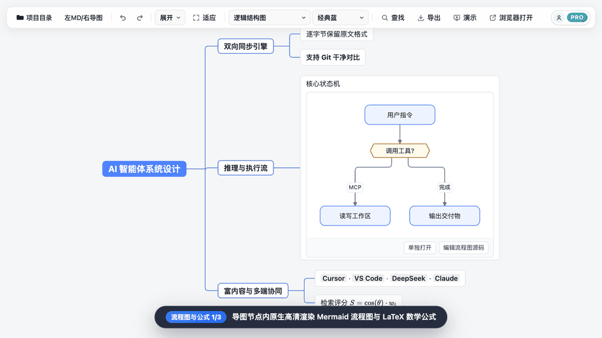
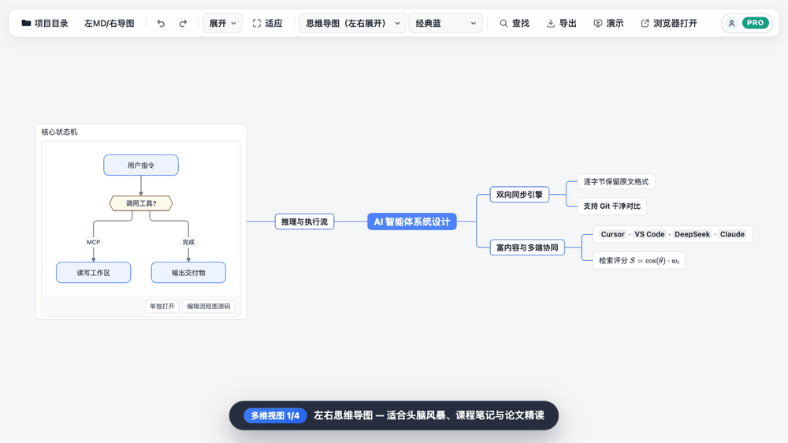
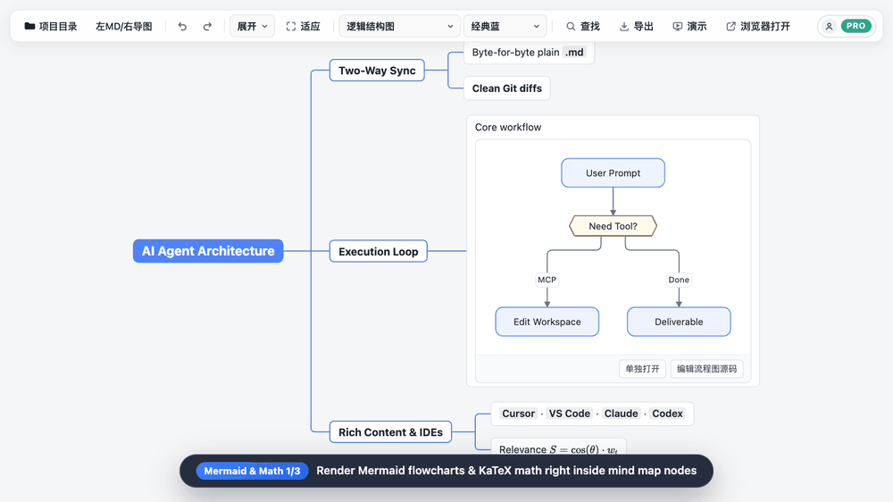
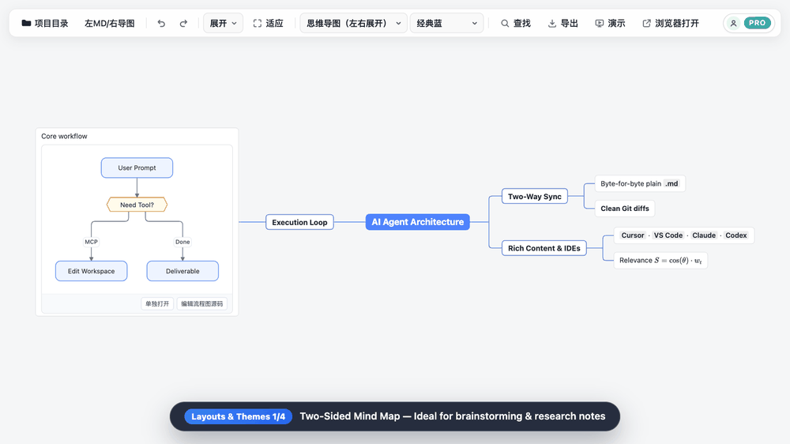

<div align="center">
  
  <h1>Inkmap（墨图）</h1>
  <p><strong>把本地 Markdown 变成可双向拖拽编辑的思维导图与 Mermaid 流程图工作台</strong></p>
  <p><em>Two-Way Editable Markdown Mindmap (Markmap) &amp; Mermaid Flowchart Editor for IDEs &amp; AI Agents</em></p>

  <p>
    <a href="https://www.zhiyuanv.com/inkmap.html"></a>
    <a href="https://open-vsx.org/extension/inkmap/inkmap-vscode"></a>
    <a href="https://marketplace.visualstudio.com/items?itemName=inkmap.inkmap-vscode"></a>
    <a href="https://www.npmjs.com/package/inkmap-mcp"></a>
  </p>

  <p>
    <a href="#简体中文"><strong>简体中文</strong></a> · <a href="#english"><strong>English</strong></a> · <a href="https://www.zhiyuanv.com/inkmap.html"><strong>在线体验台</strong></a> · <a href="https://www.zhiyuanv.com/software.html"><strong>下载与 Pro 权益</strong></a>
  </p>
</div>

---

<a id="简体中文"></a>

## 为什么选择 Inkmap？

传统 **Markmap** 只能单向只读预览，想调整分支或新增节点还得退回源码里数缩进；而传统脑图软件（`.xmind` 等）又把内容锁在私有格式里，Git 无法对比、AI 智能体也无法直接读写。

**Inkmap 让你的文件永远保持为干净的本地 `.md`，同时拥有桌面级脑图与流程图的流畅双向编辑体验：**


---

## ⚡ 30 秒快速安装与打开指南

### 方式一：一行命令自动配置本机全部 AI 客户端（推荐）

自动检测并一键配置到本机已安装的 **Cursor、VS Code、DeepSeek Harness、Claude Desktop、Claude Code、OpenAI Codex、Google Antigravity**：

```bash
npx -y inkmap-mcp@latest install
```

### 方式二：按你正在使用的平台打开导图

| 所在平台 | 安装渠道 | 3 秒打开导图的操作方式 |
| :--- | :--- | :--- |
| **Cursor / VS Code / Windsurf** | 扩展商店搜索 **`Inkmap`** 安装 | 打开任意 `.md` 文件，点击**编辑器右上角导图图标**，或右键文件选择 **`Open as Inkmap`** 即可左右并排联动编辑 |
| **TRAE（国际版 / 国内版）** | TRAE 应用市场暂时搜不到 Inkmap：下载 [`inkmap.vsix`](https://github.com/zhiyuanvision-lang/InkMap/releases/latest/download/inkmap.vsix)，在 TRAE 扩展视图菜单选择**「从 VSIX 安装」**；国际版也可运行 `npx -y inkmap-mcp@latest install trae` | 同上 |
| **DeepSeek Harness** | 插件页右上角 `+ 添加插件` 输入 **`dsh-inkmap`** | 预览任意 `.md` 文档时，点击右上角工具栏的 **「Inkmap」** 按钮即可在右侧分栏打开交互脑图 |
| **Claude / Codex / Antigravity** | 运行上方 `npx -y inkmap-mcp@latest install`（或在 Claude Code 内执行 `/plugin install inkmap --marketplace zhiyuanvision-lang/InkMap`） | 直接在对话中对 AI 说：*“用 Inkmap 打开 `README.md`”*，面板即刻自动弹出并随 AI 改稿实时刷新 |
| **Qoder / 独立浏览器三栏工作台** | 终端执行 `npx -y inkmap-mcp@latest 你的文档.md` | 直接在 Chrome/默认浏览器打开「项目目录树 + Markdown 源码 + 交互导图」全屏三栏工作台 |

> 💡 **不想装任何东西先试试手感？** 直接点开浏览器免安装体验台 👉 **[zhiyuanv.com/inkmap.html](https://www.zhiyuanv.com/inkmap.html)**

---

## 核心特性动态演示

### 1. 逐字节无损双向同步（Git Diff 极度干净）
- **左改右动、右改左动**：在画布上按 `Tab` 新增子节点、`Enter` 新增同级、鼠标拖拽重组层级，底层 `.md` 毫秒级实时写回；未修改的标题、列表符号、代码块与空行 **100% 逐字节原样保留**。
- **光标与节点双向跳转**：在 Markdown 源码移动光标，右侧导图自动聚焦对应节点；点击导图节点，左侧源码即时滚动高亮对应行，还可一键将选中分支 **`Add to Chat`** 发送给 AI 协同改写。

### 2. 节点内嵌 Mermaid 流程图、LaTeX 公式与表格实时编辑
- 告别“文字大纲和架构流程图分两个软件画”的割裂感：在导图分支下放置 ` ```mermaid ` 代码块，Inkmap 直接在节点内高清渲染**流程图、时序图、状态图**，点击 **「编辑流程图源码」** 即可实时改代码重绘，或点击 **「单独打开」** 独立弹窗无损缩放检视。



### 3. 9 种专业导图结构 · 夜色护眼主题 · 一键当 PPT 逐节点放映
- 一键切换 **逻辑结构图、左右思维导图、组织结构图、目录组织图、时间轴（横向/交错/竖向）、鱼骨图** 与 **夜色深色主题**（布局与主题自动保存在文档 YAML front matter 中）。
- 点击顶部 **「演示」** 即可进入全屏聚光灯逐节点放映模式，技术评审、论文组会与方案汇报无需再额外做 PPT；支持一键导出**高清 PNG、矢量 SVG 与单文件离线可交互 HTML**。



---

## 常用快捷键速查表

| 导图操作 | 快捷键 / 方式 | 进阶操作 | 快捷键 / 方式 |
| :--- | :--- | :--- | :--- |
| **新增子节点** | `Tab` | **编辑流程图 / 表格 / 公式源码** | 双击节点 或 `⌘E` (`Ctrl+E`) |
| **新增同级节点** | `Enter` | **上下移动当前节点顺序** | `⌘↑` / `⌘↓` (`Alt+↑` / `Alt+↓`) |
| **新增父级节点** | `⇧Tab` (`Shift+Tab`) | **展开选中节点的全部子孙** | `⇧/` 或右键菜单「展开子孙」 |
| **修改节点文字** | 选中直接打字 或 双击节点 | **全图搜索与批量替换** | `⌘F` (`Ctrl+F`) |
| **删除选中节点** | `⌫` (`Backspace` / `Delete`) | **撤销 / 重做（与编辑器共用）** | `⌘Z` / `⇧⌘Z` (`Ctrl+Z` / `Ctrl+Y`) |
| **自由重组层级** | 鼠标直接拖拽节点 | **画布平移 / 无级缩放** | 触控板双指滑动 / `⌘ + 滚轮` |

---

## 7 天免登录免费试用 & Pro 终身买断

- **免费试用**：首次安装自动享有 **7 天全功能免费试用**（无需注册或登录，文档 100% 保存在本地磁盘）。
- **一次买断 · 10 端通用**：一次性开通 **Inkmap Pro 终身版**（无任何按月/按年自动续费），验证同一邮箱即可在 **Cursor、VS Code、DeepSeek Harness、Qoder、WorkBuddy、Claude Desktop、Claude Code、OpenAI Codex、Google Antigravity、Trae** 全平台自动同步解锁。详见 [官方网站说明](https://www.zhiyuanv.com/software.html#inkmap-pricing)。

---

<a id="english"></a>

## English Guide

**Inkmap** turns plain local Markdown (`.md`, `.markmap.md`) files into a two-way interactive mind map (**Markmap** alternative) and **Mermaid** flowchart workspace — directly inside **VS Code, Cursor, Windsurf, Trae, Claude Desktop, Claude Code, OpenAI Codex, Google Antigravity, DeepSeek Harness**, or your browser.


### Quick Start (30 Seconds)

1. **One-line auto-installer for all local AI clients & IDEs**:
   ```bash
   npx -y inkmap-mcp@latest install
   ```
2. **Or install from your IDE extension marketplace**:
   - [VS Code Marketplace (`inkmap.inkmap-vscode`)](https://marketplace.visualstudio.com/items?itemName=inkmap.inkmap-vscode)
   - [Open VSX Registry (`inkmap/inkmap-vscode` for Cursor / Windsurf / VSCodium)](https://open-vsx.org/extension/inkmap/inkmap-vscode)
   - Open any `.md` file and click the **Mindmap icon** in the top-right editor title bar (or right-click -> **Open as Inkmap**).
3. **Zero-install browser playground**: Try it live right now at **[zhiyuanv.com/inkmap.html](https://www.zhiyuanv.com/inkmap.html?lang=en)**.

### Inline Mermaid Diagrams & KaTeX Math

Render and edit `mermaid` flowcharts, sequence diagrams, state machines, KaTeX formulas, and Markdown tables directly inside mind map nodes — click **Edit diagram source** (`⌘E` / `Ctrl+E`) to update diagrams live on the canvas:



### 9 Professional Layouts, Dusk Dark Theme & Presentation Mode

Switch effortlessly between **Logic Chart, Two-Sided Mind Map, Org Chart, Catalog, Timelines, and Fishbone**, toggle **Dusk dark mode**, present node-by-node in **Presentation Mode**, and export lossless **PNG, vector SVG, or standalone interactive HTML**:



---

## Monorepo Architecture & Development

| Package | Responsibility |
| :--- | :--- |
| `packages/core` | Byte-preserving Markdown ⇄ Mind Map AST parser & serializer |
| `packages/web` | Shared interactive canvas, Mermaid/KaTeX renderer & UI (`VsCodeHost`, `HttpHost`, `McpAppHost`) |
| `packages/cli` | `inkmap-mcp` CLI, loopback HTTP workspace server, file watcher & multi-client installer |
| `packages/vscode` | Native custom editor extension for VS Code, Cursor, Trae, Windsurf & VSCodium |

```bash
npm install
npm run sync:all   # Builds all platform bundles, verifies asset hash parity, and runs unit + E2E tests
```

## Privacy & License

Inkmap processes your Markdown documents **100% locally on your machine** — document contents are never uploaded to any server. Inkmap sends anonymous usage statistics (version, client, feature counts; never document content) to `zhiyuanv.com`. See [LICENSE.md](packages/vscode/LICENSE.md) and the [privacy policy](https://zhiyuanv.com/software.html#privacy).
