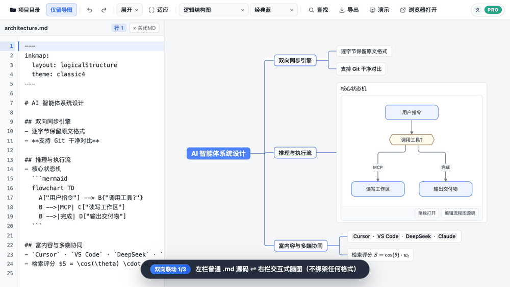
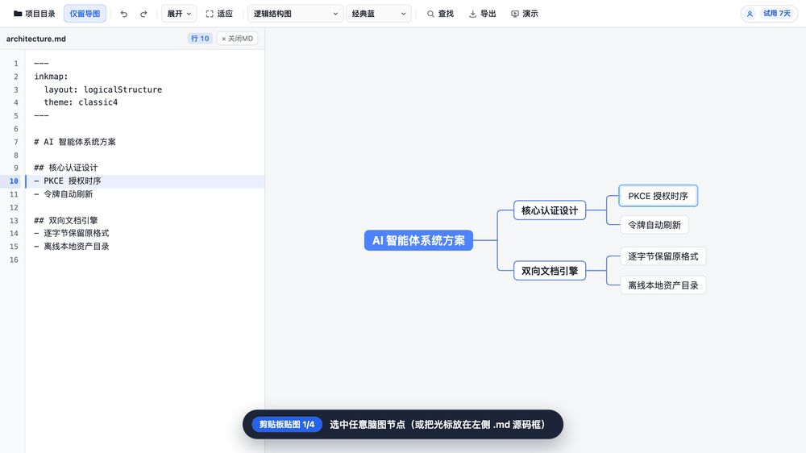
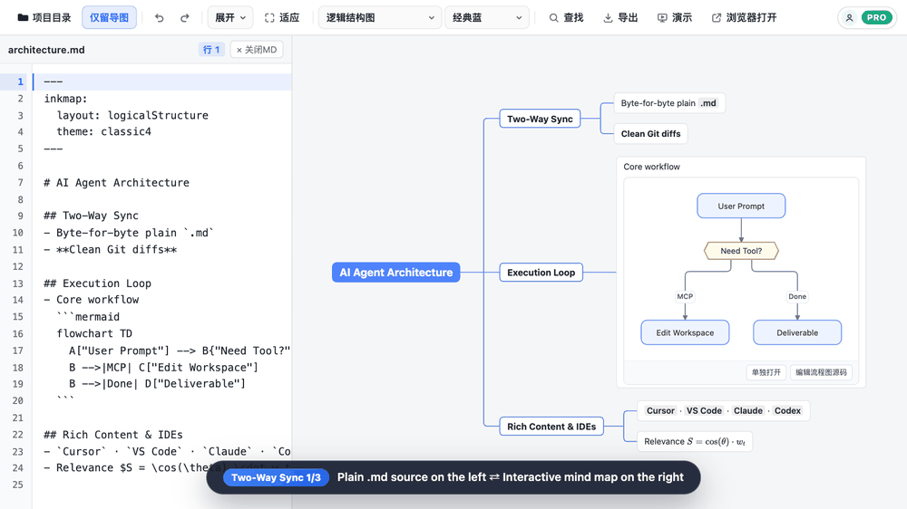
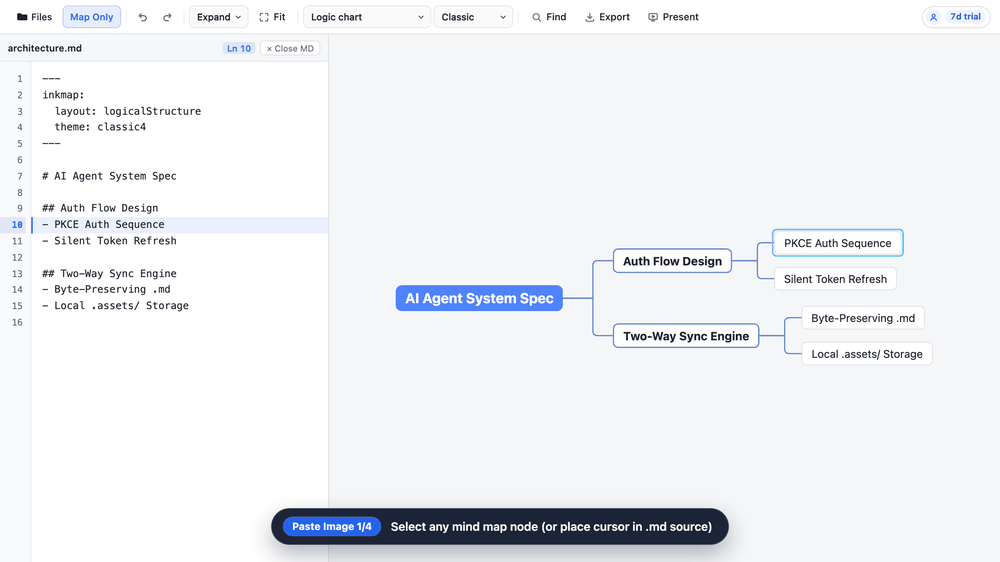

<div align="center">
  
  <h1>Markdown Mindmap · Inkmap（墨图）</h1>
  <p><strong>把 AI 生成的冗长复杂 Markdown 秒变条理清晰的可编辑思维导图、可视化 Mermaid 流程图与剪贴板贴图工作台</strong></p>
  <p><em>Turn long, messy AI Markdown (.md) into a clear, editable mind map, visual Mermaid flowchart &amp; clipboard paste-image workspace across IDEs, Desktop &amp; AI Agents</em></p>

  <p>
    <a href="https://www.zhiyuanv.com/inkmap.html"></a>
    <a href="https://www.zhiyuanv.com/software.html#desktop"></a>
    <a href="https://open-vsx.org/extension/inkmap/inkmap-vscode"></a>
    <a href="https://marketplace.visualstudio.com/items?itemName=inkmap.inkmap-vscode"></a>
    <a href="https://www.npmjs.com/package/inkmap-mcp"></a>
  </p>

  <p>
    <a href="#简体中文"><strong>简体中文</strong></a> · <a href="#english"><strong>English</strong></a> · <a href="https://www.zhiyuanv.com/inkmap.html"><strong>在线体验台</strong></a> · <a href="https://www.zhiyuanv.com/software.html#desktop"><strong>独立桌面端</strong></a> · <a href="https://www.zhiyuanv.com/software.html#inkmap-pricing"><strong>Pro 终身版</strong></a>
  </p>
</div>

---

<a id="简体中文"></a>

## 为什么程序员都在用 Inkmap 看 AI 文档？

用 Cursor、Claude Code、Codex 写代码时，AI 智能体动辄输出几百行复杂的 `PLAN.md`、架构设计与重构方案——纯文本大纲层级深、字太密，扫半天抓不住主干逻辑；传统 **Markmap** 只能只读预览不能改；换成 `.xmind` 又变成私有二进制文件，Git 无法 Diff、AI 也无法继续读写。

**Inkmap 把冗长杂乱的本地 `.md` 一键变成条理清晰的交互式思维导图，同时保留 100% 纯净的标准 Markdown 文件：**

| 核心维度 | **Inkmap（墨图）** | 传统 Markmap 插件 | 传统脑图软件 (`.xmind`) |
| :--- | :--- | :--- | :--- |
| **底层存储与 Git 友好度** | **纯本地 `.md`，逐字节保留未改行，Git Diff 极干净** | 纯 `.md`（仅只读预览） | 私有压缩包，无法直接 Git Diff |
| **画布双向拖拽与快捷键** | **`Tab` / `Enter` / 拖拽实时毫秒级写回源文件** | 不支持画布编辑 | 支持，但脱离 Markdown 生态 |
| **剪贴板截图粘贴与拖拽插图** | **`⌘V` / `Ctrl+V` 自动存至 `<文档名>.assets/` 并写相对链接** | 不支持 | 图片封死在私有包内，外部不可复用 |
| **Mermaid 流程图体验** | **节点内高清渲染 + 画布直接点击改节点/连线实时写回** | 不支持或仅静态渲染 | 需另开绘图软件导出静态图 |
| **AI 智能体与 IDE 协同** | **原生支持 VS Code / Cursor / Claude / Codex / MCP 联动** | 仅单向查看 | AI 无法直接增量读写源文件 |



---

## 安装与快速开始（30 秒上手）

### 方式一：命令行一键安装（全平台自动配置 / DeepSeek Harness / Homebrew）

自动检测并一键配置到本机已安装的 **Cursor、VS Code、Windsurf、Trae、DeepSeek Harness、Claude Desktop、Claude Code、OpenAI Codex、Google Antigravity**（下方依次为全端自动配置、DeepSeek Harness 原生插件安装、macOS Homebrew 桌面端安装）：

```bash
npx -y inkmap-mcp@latest install
dsh plugin --profile web add dsh-inkmap
brew install --cask zhiyuanvision-lang/tap/inkmap
```

### 方式二：按你正在使用的平台安装与打开

| 所在平台 | 安装渠道 | 3 秒打开导图的操作方式 |
| :--- | :--- | :--- |
| **Cursor / VS Code / Windsurf / VSCodium** | 扩展商店直接搜索 **`Inkmap`** 安装 | 打开任意 `.md` 文件，点击**首行顶部 `用 Inkmap 思维导图打开`** 或**编辑器右上角导图图标**即可左右并排联动 |
| **独立桌面客户端（macOS / Win / Linux）** | 前往 **[官网下载安装包](https://www.zhiyuanv.com/software.html#desktop)** | 无需打开代码编辑器，双击或拖入任意 `.md` 文件即可直接以全屏脑图与三栏工作台打开编辑 |
| **DeepSeek Harness** | 插件页右上角 `+ 添加插件` 输入 **`dsh-inkmap`** | 预览任意 `.md` 文档时，点击右上角工具栏 **「Inkmap 思维导图」** 即可在右侧分栏交互编辑 |
| **Claude / Codex / Antigravity** | 运行上方 `npx -y inkmap-mcp@latest install`（或 Claude Code 内执行 `/plugin install inkmap --marketplace zhiyuanvision-lang/InkMap`） | 直接在对话中对 AI 说：*“用 Inkmap 打开 `README.md`”*，面板自动弹出并随 AI 改稿实时刷新 |
| **Trae / Qoder / 浏览器三栏工作台** | 终端执行 `npx -y inkmap-mcp@latest 你的文档.md`（Trae 也可从 Release 下载 `inkmap.vsix` 安装） | 在浏览器展开「项目目录树 + Markdown 源码 + 交互导图」全屏三栏工作台 |

> 💡 **免安装直接试手感？** 点击打开浏览器在线体验台 👉 **[zhiyuanv.com/inkmap.html](https://www.zhiyuanv.com/inkmap.html)**

---

## 功能特性详解（四大核心能力）

### 1. 剪贴板截图一键粘贴 & 拖拽插图（自动落盘 `<文档名>.assets/`）
彻底告别写 Markdown 插图还要手动保存、重命名、敲路径或配图床的繁琐流程：
- **画布节点直接贴图**：选中任意导图节点后按 **`⌘V`（`Ctrl+V`）** 粘贴截图，或直接从电脑文件夹将图片（`PNG` / `JPG` / `GIF` / `WebP`，单张最大 `10 MB`）**拖入节点**，自动在该节点下生成图文子节点并实时渲染预览（连续粘贴多张截图会自动并排为同级子节点）。
- **源码与编辑框光标处插图**：在左侧 Markdown 源码栏、节点内联编辑框或节点源码面板中按 **`⌘V`（`Ctrl+V`）**，直接在光标处插入标准相对路径语法 ``。
- **零污染本地资产目录**：图片自动保存在同级 `<文档名>.assets/` 文件夹中（中文文档名原样保留可读路径，绝不覆盖已有文件），离线可用，Git 提交、Obsidian 与标准 Markdown 预览器 100% 原生兼容。（支持 VS Code、Cursor 等编辑器扩展、独立桌面端、DeepSeek Harness、Qoder 与浏览器工作台。）



### 2. 逐字节无损双向同步（Git Diff 极度干净）
- **左改右动、右改左动**：画布上按 `Tab` 新增子节点、`Enter` 新增同级、鼠标拖拽重组层级，底层 `.md` 毫秒级实时写回；未修改的标题、列表符号、代码块与空行 **100% 逐字节原样保留**。
- **光标与节点双向定位 + AI 投喂**：在 Markdown 源码移动光标，右侧导图自动聚焦对应节点；点击导图节点，左侧源码即时滚动高亮对应行，还可一键将选中分支 **`添加到对话 (Add to Chat)`** 发送给 AI 协同改写。

### 3. 节点内嵌可视化 Mermaid 流程图、LaTeX 公式与表格
- **架构大纲与流程图合二为一**：在导图分支下放置 ` ```mermaid ` 代码块，直接在节点内高清渲染**流程图、时序图、状态图**，同时支持 **LaTeX 数学公式**（`$...$` / `$$...$$`）与 **Markdown 表格**。
- **直接点击节点可视化改流程图**：点击 **「单独打开」** 进入独立大图检视器，可直接点击流程图中的任意节点、连线或子图标题进行原地改名、`Tab` 续接下一节点、连线、切换图形（矩形/菱形/胶囊/数据库等）与撤销重做，每一处改动自动同步写回 `.md` 中的 Mermaid 代码块！


### 4. 9 种专业导图结构 · 夜色护眼深色主题 · 一键当 PPT 逐节点放映
- 一键切换 **左右思维导图、逻辑结构图、组织结构图、目录组织图、时间轴（横向/交错/竖向）、鱼骨图** 与 **夜色深色主题**（配置自动保存在文档 YAML front matter 中）。
- 点击顶部 **「演示」** 进入全屏聚光灯逐节点放映模式，技术评审、论文组会与方案汇报无需额外做 PPT；支持一键导出**高清无损 PNG、矢量 SVG 与单文件离线可交互 HTML**。


---

## 配置与快捷键速查表

| 导图核心操作 | 快捷键 / 方式 | 图文与进阶操作 | 快捷键 / 方式 |
| :--- | :--- | :--- | :--- |
| **新增子节点 / 同级节点** | `Tab` / `Enter` | **粘贴剪贴板截图（生成子图或光标插图）** | **`⌘V`（`Ctrl+V`）或直接拖入图片** |
| **新增父级节点** | `⇧Tab`（`Shift+Tab`） | **编辑节点流程图 / 表格 / 公式源码** | 双击节点 或 `⌘E`（`Ctrl+E`） |
| **修改节点文字** | 选中直接打字 或 双击节点 | **上下移动同级节点顺序** | `⌘↑` / `⌘↓`（`Alt+↑` / `Alt+↓`） |
| **删除节点 / 拖拽重组** | `⌫`（`Backspace`）/ 鼠标拖拽 | **展开选中节点的全部子孙** | `⇧/` 或右键菜单「展开子孙」 |
| **立即保存文档** | `⌘S`（`Ctrl+S`） | **全图查找与批量替换** | `⌘F`（`Ctrl+F`） |
| **撤销 / 重做** | `⌘Z` / `⇧⌘Z`（`Ctrl+Z` / `Ctrl+Y`） | **画布平移 / 无级缩放** | 触控板双指滑动 / `⌘ + 滚轮` |

---

## 🎁 7 天免登录免费试用 & Pro 终身买断

- **免费试用**：首次安装自动享有 **7 天全功能免费试用**（无需注册或登录，文档与图片资产 100% 保存在本机磁盘）。
- **一次买断 · 多端通用**：一次性开通 **Inkmap Pro 终身版**（无任何按月/按年自动续费），验证同一邮箱即可在 **桌面客户端、Cursor、VS Code、Windsurf、Trae、DeepSeek Harness、Qoder、WorkBuddy、Claude Desktop、Claude Code、OpenAI Codex、Google Antigravity** 全平台自动同步解锁。详见 [官方网站说明](https://www.zhiyuanv.com/software.html#inkmap-pricing)。

---

<a id="english"></a>

## English Guide — Markdown Mindmap · Inkmap

**Turn long, messy AI-generated Markdown (`PLAN.md`, specs, PRDs, architecture notes) into a clear, two-way editable mind map** (**Markmap** alternative), **visual Mermaid flowchart editor**, and **clipboard paste-image workspace** — directly inside **VS Code, Cursor, Windsurf, Trae, the Native Desktop App (macOS / Windows / Linux), Claude Desktop, Claude Code, OpenAI Codex, Google Antigravity, DeepSeek Harness**, or your browser.

| Capability | **Inkmap** | Read-Only Markmap | Proprietary `.xmind` Tools |
| :--- | :--- | :--- | :--- |
| **Storage & Git Diff** | **Plain local `.md`, byte-preserving round-trip** | Plain `.md` (read-only) | Binary archive (unreadable in Git) |
| **Canvas Editing** | **Two-way `Tab` / `Enter` / drag-and-drop sync** | No canvas editing | Yes, locked inside proprietary format |
| **Clipboard Paste & Drop Images** | **`⌘V` / `Ctrl+V` saves to `<doc>.assets/` + links `.md`** | Not supported | Locked inside binary bundle |
| **Mermaid Flowcharts** | **Inline rendering + direct visual click-to-edit nodes/edges** | Static or unsupported | Separate diagramming tool required |
| **AI Agent & IDE Workflow** | **Add-to-Chat + live MCP sync across 10+ hosts** | View only | Opaque to coding agents |



### Quick Start (30 Seconds)

1. **One-line auto-installer for all local AI clients & IDEs**:
   ```bash
   npx -y inkmap-mcp@latest install
   ```
2. **IDE Extension Marketplaces**:
   - [VS Code Marketplace (`inkmap.inkmap-vscode`)](https://marketplace.visualstudio.com/items?itemName=inkmap.inkmap-vscode) · [Open VSX Registry (`inkmap/inkmap-vscode` for Cursor / Windsurf / VSCodium)](https://open-vsx.org/extension/inkmap/inkmap-vscode)
   - Open any `.md` file and click **`⇄ Open as Inkmap Mind Map`** at line 1 (or the **Mindmap icon** in the top-right editor bar).
3. **Standalone Desktop App (macOS / Windows / Linux)**:
   - Download at **[zhiyuanv.com/software.html#desktop](https://www.zhiyuanv.com/software.html#desktop)** — open and edit `.md` mind maps directly without launching an IDE.
4. **Zero-install browser playground**: Try it live at **[zhiyuanv.com/inkmap.html](https://www.zhiyuanv.com/inkmap.html?lang=en)**.

### Features

- **Paste & Drop Screenshots Straight into Markdown (`<doc>.assets/`)**: Press `⌘V` / `Ctrl+V` on any selected node to attach a clipboard screenshot as a child image node, paste inside any Markdown/node editor to insert `` at the cursor, or drag `PNG` / `JPG` / `GIF` / `WebP` files (up to `10 MB`) onto a node. Images are saved locally right beside your document with clean relative links — never overwriting existing files and requiring zero cloud hosting. *(Supported in VS Code, Cursor & compatible IDEs, Desktop App, DeepSeek Harness, Qoder, and the Browser Editor.)*


- **Visual Inline Mermaid Flowcharts & KaTeX Math**: Render `mermaid` flowcharts, sequence diagrams, state machines, KaTeX math (`$...$` / `$$...$$`), and tables inside mind map nodes. Open the diagram viewer to **click any flowchart node or edge to rename, add next steps (`Tab`), connect nodes, or switch shapes visually** — written straight back to your Mermaid source:


- **9 Professional Layouts, Dusk Dark Theme & Presentation Mode**: Switch effortlessly between **Two-Sided Mind Map, Logic Chart, Org Chart, Catalog, Timelines, and Fishbone**, toggle **Dusk dark mode**, present node-by-node in **Presentation Mode**, and export lossless **PNG, vector SVG, or standalone interactive HTML**:


---

## Monorepo Architecture & Development

| Package | Responsibility |
| :--- | :--- |
| `packages/core` | Byte-preserving Markdown ⇄ Mind Map AST parser, Mermaid editor & `.assets/` image helpers |
| `packages/web` | Shared interactive canvas, visual Mermaid/KaTeX renderer, image paste & UI (`VsCodeHost`, `HttpHost`, `McpAppHost`) |
| `packages/cli` | `inkmap-mcp` CLI, loopback HTTP workspace server, local `.assets/` writer & multi-client installer |
| `packages/vscode` | Native custom editor extension for VS Code, Cursor, Trae, Windsurf & VSCodium |
| `packages/desktop` | Cross-platform Electron desktop app for macOS, Windows & Ubuntu Linux |

```bash
npm install
npm run sync:all   # Builds all platform bundles, verifies asset hash parity, and runs unit + E2E + regression suites
```

## Privacy & License

Inkmap processes your Markdown documents and `<doc>.assets/` images **100% locally on your machine** — document contents are never uploaded to any server. See [LICENSE.md](packages/vscode/LICENSE.md).
