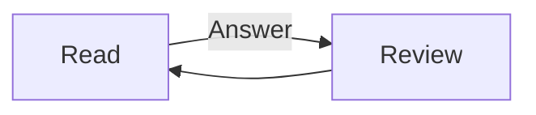

# Diagram editing



- Word practice

  ```mermaid
  stateDiagram-v2
    [*] --> New
    New --> Review: Answered correctly
    note right of Review
      Keep practicing
    end note
  ```

- Original Markdown stays editable
