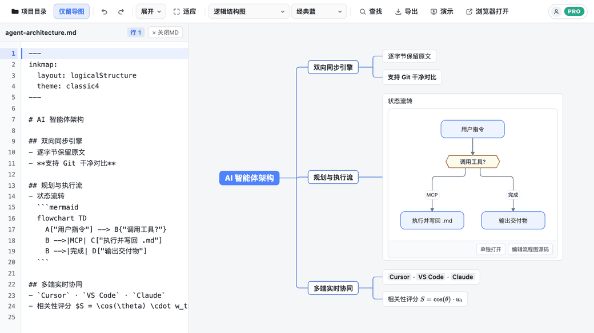
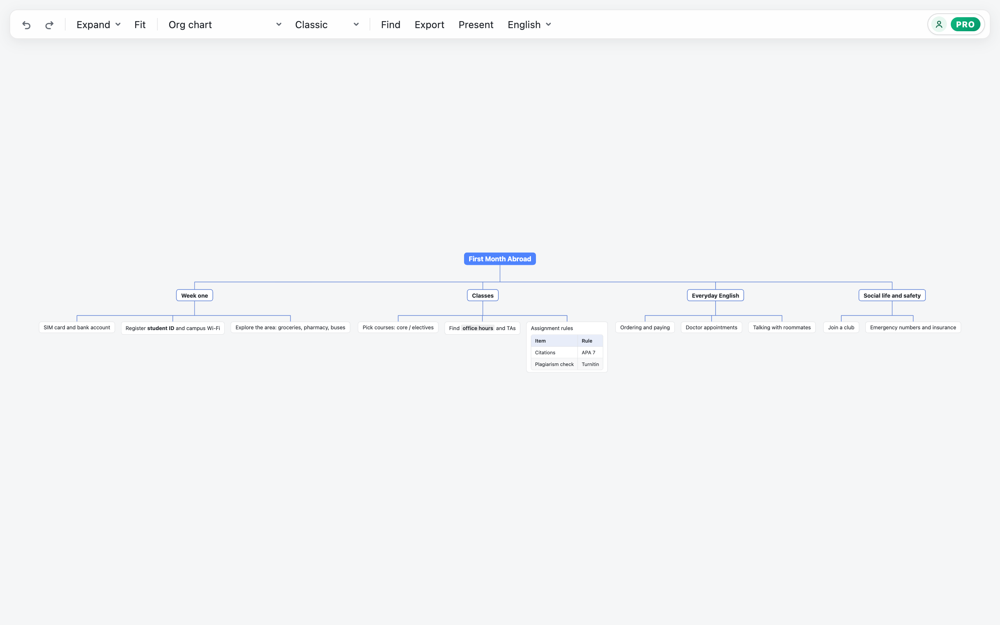
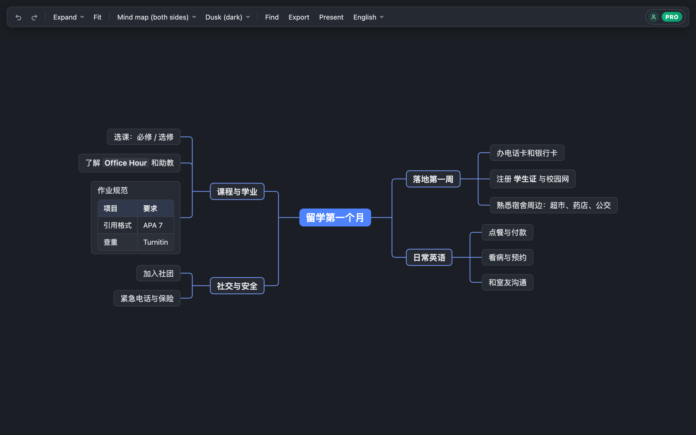
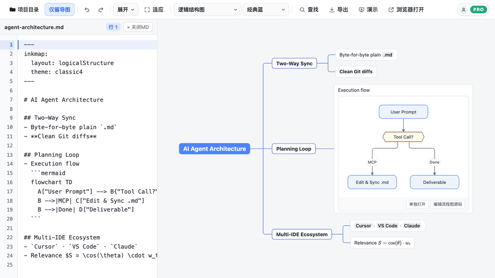
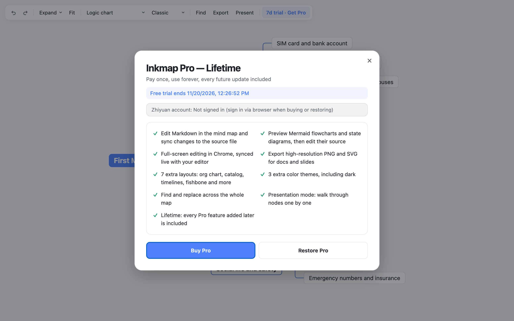

# Inkmap 墨图 — Markdown 思维导图 & Mermaid 流程图

[English](#english) · [⚡ 在线免安装体验台 (Live Playground)](https://zhiyuanv.com/inkmap.html)

把 Markdown 大纲当作思维导图来编辑。导图里的每一处改动都实时写回 Markdown，Markdown 的改动也立即出现在导图里。文件始终是普通 Markdown，Git、笔记软件和 AI 智能体都能直接读写。

## 为什么用 Inkmap

- **文件就是 Markdown**：不用导入导出，也不依赖私有格式。没改动的部分逐字节保留原文，Git diff 干净。
- **两栏联动**：左边 Markdown、右边导图。在 Markdown 中移动光标，导图定位到对应节点；点击节点，Markdown 跳到对应行。
- **与编辑器共用撤销记录**：导图中的修改就是对文档的普通编辑，`⌘Z` / `⇧⌘Z` 随时撤回。
- **富内容节点**：支持 LaTeX 公式、表格、图片、代码和加粗；双击节点即可编辑源码。
- **流程图**：预览 Mermaid 流程图和状态图，并直接编辑图表源码。
- **中英文界面**：默认英文，可在导图工具栏切换为中文。

在 Markdown 中保留带有 `mermaid` 语言标记的围栏代码块，Inkmap 会在节点中预览流程图或状态图。点击图下方的「编辑流程图源码」，即可修改节点文字、状态、连线或备注，改动会同步回原文件。

## 7 天免费试用与 Inkmap Pro 终身会员

首次安装起可**免登录免费试用全部 Pro 功能 7 天**。原始 Markdown 文件始终保存在本地，随时可在任意文本编辑器中打开。

### Inkmap Pro 终身会员价格与权益

- **中国大陆买断价格**：**¥29.9**（一次付费 · 终身永久使用 · 无任何自动续费）
- **立即购买入口**：在导图工具栏右上角点击账号按钮选择 **「立即开通 Pro（¥29.9）」** 直接在插件内微信扫码开通 ｜ [**🌐 访问中文官网定价与权益页**](https://zhiyuanv.com/software.html?lang=zh#inkmap-pricing)

| Pro 终身会员核心权益 | 权益详情说明 |
| --- | --- |
| **1. Markdown 与思维导图实时双向同步** | 在导图上增删改节点实时写回 `.md` 原文件；在左侧源码修改即时刷新导图，行号与节点双向联动定位 |
| **2. Mermaid 流程图 / 状态图预览与编辑** | 节点内直接高清渲染 Mermaid 流程图与状态图，支持放大预览与一键打开图表源码编辑 |
| **3. 浏览器三栏 IDE 工作台全屏编辑** | 支持在 Chrome 等浏览器中打开「左侧项目目录树 + 中间 Markdown 源码 + 右侧思维导图」三栏全屏工作台 |
| **4. 9 种专业导图结构与护眼深色主题** | 解锁组织结构图、目录组织图、时间轴（横向/交错/竖向）、鱼骨图、向左逻辑图及多套配色（含夜色深色主题） |
| **5. 高清 PNG 与矢量 SVG 一键导出** | 一键导出带完整公式、表格与流程图的透明/高清 PNG 图片及矢量 SVG，直接放入文档与 PPT |
| **6. 富文本节点与全图查找批量替换** | 完整支持 LaTeX 数学公式、Markdown 表格、代码块、图片，支持整张导图关键字查找与一键全部替换 |
| **7. 逐节点聚焦演示放映模式** | 一键进入全屏演示模式，按分支/节点逐步聚焦放映，适合技术评审、课程讲解与汇报 |
| **8. 一次买断 · 跨平台全客户端通用** | 登录同一邮箱即可在 **Cursor、VS Code、DeepSeek Harness、Qoder、WorkBuddy、Claude Desktop、Claude Code、OpenAI Codex、Google Antigravity、Trae** 全端自动同步 Pro 权益，免费包含后续全部更新 |

### 购买与激活方式

1. **插件内直接开通**：点击导图工具栏右上角账号按钮，选择 **「立即开通 Pro（¥29.9）」**，验证邮箱后直接在面板内微信扫码即可解锁（或访问 [https://zhiyuanv.com/software.html?lang=zh#inkmap-pricing](https://zhiyuanv.com/software.html?lang=zh#inkmap-pricing)）。
2. **输入 6 位验证码自动登录**：邮箱验证输入满 6 位数字自动提交完成登录，无需多余跳转。
3. **跨端自动同步**：在其他电脑或任意 AI 客户端（Cursor、VS Code、DeepSeek Harness、Qoder、WorkBuddy、Claude、Codex、Antigravity、Trae）点击右上角登录同一邮箱，已有 Pro 权益自动同步。

支持购买后 14 天内无理由全额退款。

## 使用方法

- **编辑器旁边**：打开 `.md` 文件，点编辑器右上角的导图按钮；或在资源管理器、编辑区、标签页上右键选「Open as Inkmap」。
- **浏览器（Pro）**：点地球按钮，或运行命令「Inkmap: 在浏览器中打开思维导图」。

| 操作 | 按键 |
| --- | --- |
| 新增同级 / 子节点 | `Enter` / `Tab` |
| 编辑节点 | 双击，或选中后直接输入 |
| 编辑表格、图片等富内容 | 双击节点，或 `⌘E` / `Ctrl+E` 打开源码面板 |
| 删除 | `Delete` / `Backspace` |
| 展开选中节点的所有子孙节点 | `Shift+/`、右键菜单，或工具栏「展开子孙」 |
| 查找 / 替换（Pro） | `⌘F` / `Ctrl+F` |
| 撤销 / 重做 | `⌘Z` / `⇧⌘Z`（与 Markdown 共用撤销记录） |
| 移动节点 | 拖动 |

所选的结构和配色保存在文档的 front matter 中（`inkmap.layout`、`inkmap.theme`），换台电脑打开也一样。

### 设置

- `inkmap.browser`：`chrome`（默认）或 `default`（系统默认浏览器）。
- `inkmap.browserAutoSave`：在浏览器中修改后是否自动保存文档，默认开启。

## 隐私

Inkmap 不收集、不上传你的文档，没有任何使用统计或跟踪。详见 [用户许可协议](LICENSE.md)。

---

## English

[⚡ Try Zero-Install Live Playground in Browser](https://zhiyuanv.com/inkmap.html?lang=en)

Edit Markdown outlines as mind maps. Every change in the map is written straight back to the Markdown, and edits to the Markdown show up in the map immediately. Your file stays plain Markdown that Git, note apps and AI agents can read and write.

### Why Inkmap

- **The file is just Markdown** — no import, no export, no proprietary format. Untouched parts are kept byte for byte, so Git diffs stay clean.
- **Linked panes** — Markdown on the left, map on the right. Move the cursor and the map follows; click a node and the Markdown jumps to its line.
- **One undo history** — map edits are ordinary document edits, so `⌘Z` / `⇧⌘Z` just work.
- **Rich nodes** — render LaTeX formulas, tables, images, code and emphasis; double-click a node to edit its source.
- **Flowcharts** — preview Mermaid flowcharts and state diagrams and edit their source.
- **English and Chinese UI**, following your editor's display language.

Keep flowcharts and state diagrams in fenced `mermaid` blocks. Inkmap renders them in the map. Select **Edit diagram source** to change labels, states, transitions or notes and sync the edits back to the Markdown document.

### 7-Day Free Trial & Inkmap Pro Lifetime License

Try all Pro features free for **7 days** from first use — no sign-in required. Your Markdown files are always saved locally as standard plain-text `.md` files.

#### Inkmap Pro Price & Lifetime Benefits

- **Lifetime License Price**: **\$15** (One-time payment · Use forever · No recurring subscription)
- **Purchase Links**: Open the top-right account panel in the Inkmap toolbar and choose **Buy Pro (\$15)** ｜ [**🌐 Official Website & Pricing Details**](https://zhiyuanv.com/software.html?lang=en#inkmap-pricing)

| Inkmap Pro Lifetime Benefit | What's Included |
| --- | --- |
| **1. Two-Way Live Markdown & Mind Map Sync** | Every edit on the canvas writes back to `.md` cleanly; clicking a line in Markdown locates and selects the node in the map, and vice versa |
| **2. Mermaid Flowcharts & State Diagrams** | Render Mermaid flowcharts and state diagrams directly inside nodes with zoom preview and one-click diagram source editing |
| **3. Full-Screen 3-Column Browser IDE Workspace** | Open in Chrome/Safari with a Cursor-style Project File Tree Explorer + resizable live Markdown split pane + interactive mind map |
| **4. 9 Professional Layouts & Dark Themes** | Unlock Org Chart, Catalog, Alternating/Vertical Timelines, Fishbone, Left Logic Chart, and 4 color themes including Dusk dark mode |
| **5. High-Resolution PNG & Vector SVG Export** | One-click export to crisp PNG images and standalone vector SVGs (including math, tables, and diagrams) ready for slides and docs |
| **6. Rich Nodes & Global Find & Replace** | Full support for LaTeX math, Markdown tables, code blocks, images, plus whole-map search and batch replace |
| **7. Step-by-Step Presentation Mode** | Present your mind map node by node in fullscreen with keyboard or on-screen playback controls |
| **8. Pay Once · Sync Across All Clients** | Sign in with the same email to sync Lifetime Pro across **Cursor, VS Code, DeepSeek Harness, Qoder, WorkBuddy, Claude Desktop, Claude Code, OpenAI Codex, Google Antigravity, and Trae**, including all future updates |

#### Buying and Activating

1. **In-Extension Direct Checkout**: Open the account panel at the top-right of the Inkmap toolbar and click **Buy Pro (\$15)** (or visit [https://zhiyuanv.com/software.html?lang=en#inkmap-pricing](https://zhiyuanv.com/software.html?lang=en#inkmap-pricing)).
2. **One-Step Email Verification**: Enter your email and 6-digit verification code (auto-verifies on the 6th digit) and pay **\$15** once by card (no recurring fees).
3. **Sync Across All Devices & AI Clients**: On any other machine or inside Cursor, VS Code, DeepSeek Harness, Qoder, WorkBuddy, Claude Desktop, Claude Code, OpenAI Codex, Google Antigravity, or Trae, click the top-right account badge and verify the same email to sync Lifetime Pro automatically.

Backed by a 14-day full refund guarantee.

### Usage

- **Beside the editor**: open a `.md` file and click the map button at the top right of the editor, or right-click the file, editor or tab and choose **Open as Inkmap**.
- **In the browser (Pro)**: click the globe button or run **Inkmap: Open Mind Map in Browser**.

| Action | Keys |
| --- | --- |
| New sibling / child | `Enter` / `Tab` |
| Edit a node | Double-click, or just start typing |
| Edit tables, images and other rich content | Double-click, or `⌘E` / `Ctrl+E` for the source panel |
| Delete | `Delete` / `Backspace` |
| Expand everything under the selected node | `Shift+/`, the context menu, or **Expand branch** |
| Find / replace (Pro) | `⌘F` / `Ctrl+F` |
| Undo / redo | `⌘Z` / `⇧⌘Z` (shared with the Markdown) |
| Move a node | Drag |

The chosen layout and theme are stored in the document's front matter (`inkmap.layout`, `inkmap.theme`), so the map looks the same on every machine.

#### Settings

- `inkmap.browser`: `chrome` (default) or `default` (system browser).
- `inkmap.browserAutoSave`: save the document automatically after editing in the browser (on by default).

### Privacy

Inkmap never collects or uploads your documents and does no analytics or tracking. See the [license agreement](LICENSE.md).
