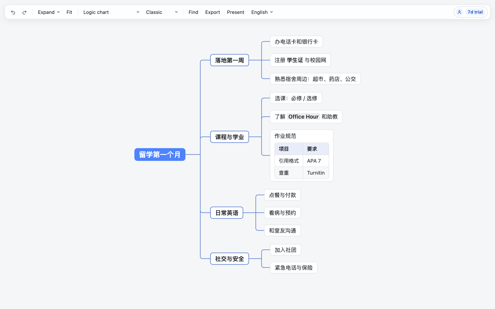
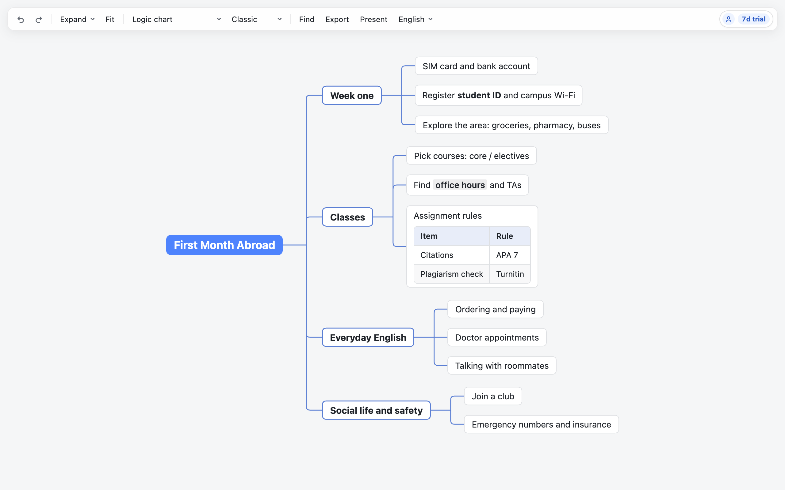

# Inkmap 墨图 — Markdown 思维导图

[English](#english)

把 Markdown 大纲当作思维导图来编辑。导图里的每一处改动都实时写回 Markdown，Markdown 的改动也立即出现在导图里。文件始终是普通 Markdown，Git、笔记软件和 AI 智能体都能直接读写。

## 为什么用 Inkmap

- **文件就是 Markdown**：不用导入导出，也不依赖私有格式。没改动的部分逐字节保留原文，Git diff 干净。
- **两栏联动**：左边 Markdown、右边导图。在 Markdown 中移动光标，导图定位到对应节点；点击节点，Markdown 跳到对应行。
- **与编辑器共用撤销记录**：导图中的修改就是对文档的普通编辑，`⌘Z` / `⇧⌘Z` 随时撤回。
- **富内容节点**：支持 LaTeX 公式、表格、图片、代码和加粗；双击节点即可编辑源码。
- **流程图**：预览 Mermaid 流程图和状态图，并直接编辑图表源码。
- **中英文界面**：默认英文，可在导图工具栏切换为中文。

在 Markdown 中保留带有 `mermaid` 语言标记的围栏代码块，Inkmap 会在节点中预览流程图或状态图。点击图下方的「编辑流程图源码」，即可修改节点文字、状态、连线或备注，改动会同步回原文件。

## 7 天免费试用与购买

首次使用起可免登录试用全部功能 7 天。到期后需一次性购买 Inkmap Pro 才能继续使用。原始 Markdown 文件仍可在文本编辑器中打开。

试用包含 Chrome 全屏编辑、PNG 和 SVG 导出、更多导图结构与配色、查找替换及演示模式。购买包含后续更新。

### 购买与激活

1. 点导图工具栏右侧的云帆账号入口，选择「购买 Pro」，或运行命令 **Inkmap: 升级到 Inkmap Pro**。
2. 浏览器直接打开 Inkmap Pro 结账页，登录云帆平台账号并微信扫码付款。
3. 付款后返回编辑器，Pro 会自动解锁。换设备或编辑器时，点「登录」并使用同一个云帆账号，已有权益会自动同步。

购买后 7 天内可申请全额退款。

## 使用方法

- **编辑器旁边**：打开 `.md` 文件，点编辑器右上角的导图按钮；或在资源管理器、编辑区、标签页上右键选「Open as Inkmap」。
- **浏览器（Pro）**：点地球按钮，或运行命令「Inkmap: 在浏览器中打开思维导图」。

| 操作 | 按键 |
| --- | --- |
| 新增同级 / 子节点 | `Enter` / `Tab` |
| 编辑节点 | 双击，或选中后直接输入 |
| 编辑表格、图片等富内容 | 双击节点，或 `⌘E` / `Ctrl+E` 打开源码面板 |
| 删除 | `Delete` / `Backspace` |
| 展开选中节点的所有子孙节点 | `Shift+/`、右键菜单，或工具栏「展开子孙」 |
| 查找 / 替换（Pro） | `⌘F` / `Ctrl+F` |
| 撤销 / 重做 | `⌘Z` / `⇧⌘Z`（与 Markdown 共用撤销记录） |
| 移动节点 | 拖动 |

所选的结构和配色保存在文档的 front matter 中（`inkmap.layout`、`inkmap.theme`），换台电脑打开也一样。

### 设置

- `inkmap.browser`：`chrome`（默认）或 `default`（系统默认浏览器）。
- `inkmap.browserAutoSave`：在浏览器中修改后是否自动保存文档，默认开启。

## 隐私

Inkmap 不收集、不上传你的文档，没有任何使用统计或跟踪。详见 [用户许可协议](LICENSE.md)。

---

## English

Edit Markdown outlines as mind maps. Every change in the map is written straight back to the Markdown, and edits to the Markdown show up in the map immediately. Your file stays plain Markdown that Git, note apps and AI agents can read and write.

### Why Inkmap

- **The file is just Markdown** — no import, no export, no proprietary format. Untouched parts are kept byte for byte, so Git diffs stay clean.
- **Linked panes** — Markdown on the left, map on the right. Move the cursor and the map follows; click a node and the Markdown jumps to its line.
- **One undo history** — map edits are ordinary document edits, so `⌘Z` / `⇧⌘Z` just work.
- **Rich nodes** — render LaTeX formulas, tables, images, code and emphasis; double-click a node to edit its source.
- **Flowcharts** — preview Mermaid flowcharts and state diagrams and edit their source.
- **English and Chinese UI**, following your editor's display language.

Keep flowcharts and state diagrams in fenced `mermaid` blocks. Inkmap renders them in the map. Select **Edit diagram source** to change labels, states, transitions or notes and sync the edits back to the Markdown document.

### 7-day free trial and purchase

Try all features for 7 days from first use without signing in. After the trial, a one-time Inkmap Pro purchase is required to continue using Inkmap. Your Markdown files remain accessible in your text editor.

The trial includes full-screen editing in Chrome, PNG and SVG export, additional layouts and themes, find and replace, and presentation mode. Purchase includes future updates.

#### Buying and activating

1. Open the account panel on the right of the map toolbar and choose **Buy Pro**, or run **Inkmap: Get Inkmap Pro**.
2. In the Inkmap Pro checkout, sign in to Yunfan and pay with WeChat Pay.
3. Return to the editor. Pro unlocks automatically. On another device or editor, choose **Sign in** and use the same Yunfan account to sync your access.

You can request a full refund within 7 days of purchase.

### Usage

- **Beside the editor**: open a `.md` file and click the map button at the top right of the editor, or right-click the file, editor or tab and choose **Open as Inkmap**.
- **In the browser (Pro)**: click the globe button or run **Inkmap: Open Mind Map in Browser**.

| Action | Keys |
| --- | --- |
| New sibling / child | `Enter` / `Tab` |
| Edit a node | Double-click, or just start typing |
| Edit tables, images and other rich content | Double-click, or `⌘E` / `Ctrl+E` for the source panel |
| Delete | `Delete` / `Backspace` |
| Expand everything under the selected node | `Shift+/`, the context menu, or **Expand branch** |
| Find / replace (Pro) | `⌘F` / `Ctrl+F` |
| Undo / redo | `⌘Z` / `⇧⌘Z` (shared with the Markdown) |
| Move a node | Drag |

The chosen layout and theme are stored in the document's front matter (`inkmap.layout`, `inkmap.theme`), so the map looks the same on every machine.

#### Settings

- `inkmap.browser`: `chrome` (default) or `default` (system browser).
- `inkmap.browserAutoSave`: save the document automatically after editing in the browser (on by default).

### Privacy

Inkmap never collects or uploads your documents and does no analytics or tracking. See the [license agreement](LICENSE.md).
