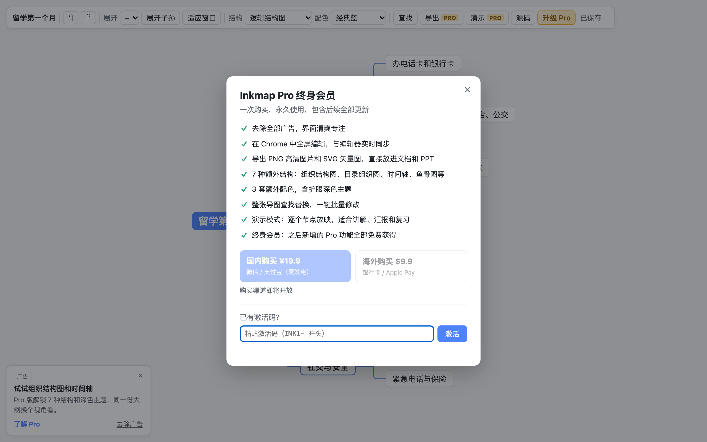
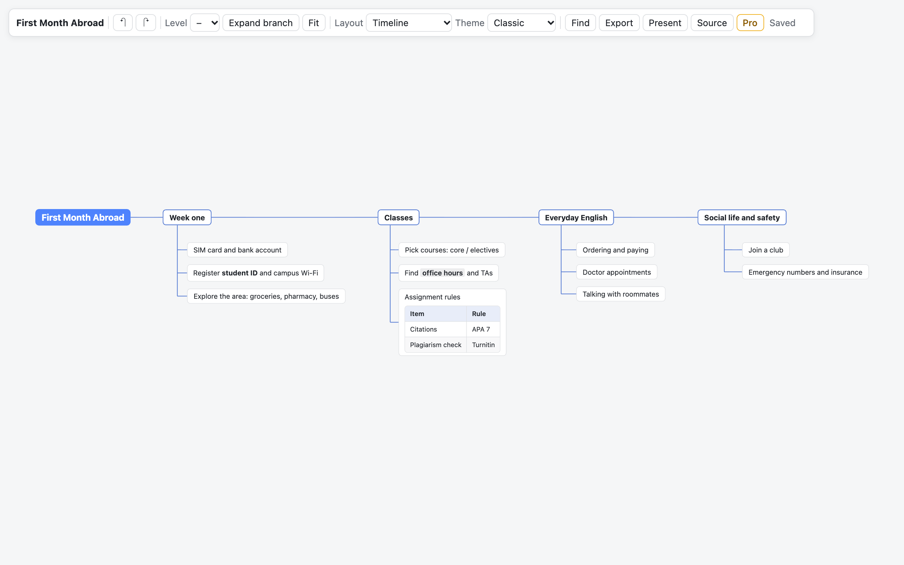

# Inkmap 墨图 — Markdown 思维导图

[English](#english)

把 Markdown 大纲当作思维导图来编辑。导图里的每一处改动都实时写回 Markdown，Markdown 的改动也立即出现在导图里。文件始终是普通 Markdown，Git、笔记软件和 AI 智能体都能直接读写。

## 为什么用 Inkmap

- **文件就是 Markdown**：不用导入导出，也不依赖私有格式。没改动的部分逐字节保留原文，Git diff 干净。
- **两栏联动**：左边 Markdown、右边导图。在 Markdown 中移动光标，导图定位到对应节点；点击节点，Markdown 跳到对应行。
- **与编辑器共用撤销记录**：导图中的修改就是对文档的普通编辑，`⌘Z` / `⇧⌘Z` 随时撤回。
- **富内容节点**：表格、图片、代码、加粗都按 Markdown 渲染；双击节点即可编辑源码。
- **中英文界面**：跟随编辑器的显示语言。

## 免费版与 Pro

免费版可以完整编辑导图，不限文件数量、不限节点数量，也可以商用。免费版在导图角落显示一条小广告，可以随时关闭 15 分钟。

**Pro 终身会员：国内 ¥19.9，海外 $9.9。一次购买，永久使用，包含后续全部更新。**

| 功能 | 免费版 | Pro |
| --- | :---: | :---: |
| 编辑导图、两栏联动、富内容节点 | ✓ | ✓ |
| 逻辑结构图、左右分布导图 | ✓ | ✓ |
| 经典配色 | ✓ | ✓ |
| 查找节点 | ✓ | ✓ |
| **无广告** |  | ✓ |
| **在 Chrome 中全屏编辑**，与编辑器实时同步 |  | ✓ |
| **导出 PNG 高清图片和 SVG 矢量图**，直接放进文档和 PPT |  | ✓ |
| **7 种额外结构**：向左逻辑图、组织结构图、目录组织图、时间轴、交错时间轴、竖向时间轴、鱼骨图 |  | ✓ |
| **3 套额外配色**：薄荷、暖阳、护眼深色 |  | ✓ |
| **查找替换**：整张导图一键批量修改 |  | ✓ |
| **演示模式**：逐个节点放映，适合讲解、汇报和复习 |  | ✓ |
| **之后新增的 Pro 功能** |  | ✓ 免费获得 |

一杯奶茶的价格，换来没有广告的工作区、能直接放进 PPT 的导图图片，以及以后所有新功能。

### 购买与激活

1. 点导图工具栏的「升级 Pro」，或运行命令 **Inkmap: 升级到 Inkmap Pro**。
2. 国内用微信 / 支付宝在爱发电购买；海外用银行卡在 Creem 购买。付款后立即收到 `INK1-` 开头的激活码。
3. 在升级窗口粘贴激活码，或运行命令 **Inkmap: 输入激活码**。

激活在本机离线完成，不需要账号。同一激活码可以用在你自己的所有设备上；开启设置同步时会自动同步到其他设备。购买后 7 天内不满意可全额退款。

## 使用方法

- **编辑器旁边**：打开 `.md` 文件，点编辑器右上角的导图按钮；或在资源管理器、编辑区、标签页上右键选「Open as Inkmap」。
- **浏览器（Pro）**：点地球按钮，或运行命令「Inkmap: 在浏览器中打开思维导图」。

| 操作 | 按键 |
| --- | --- |
| 新增同级 / 子节点 | `Enter` / `Tab` |
| 编辑节点 | 双击，或选中后直接输入 |
| 编辑表格、图片等富内容 | 双击节点，或 `⌘E` / `Ctrl+E` 打开源码面板 |
| 删除 | `Delete` / `Backspace` |
| 展开选中节点的所有子孙节点 | `Shift+/`、右键菜单，或工具栏「展开子孙」 |
| 查找 / 替换（Pro） | `⌘F` / `Ctrl+F` |
| 撤销 / 重做 | `⌘Z` / `⇧⌘Z`（与 Markdown 共用撤销记录） |
| 移动节点 | 拖动 |

所选的结构和配色保存在文档的 front matter 中（`inkmap.layout`、`inkmap.theme`），换台电脑打开也一样。

### 设置

- `inkmap.browser`：`chrome`（默认）或 `default`（系统默认浏览器）。
- `inkmap.browserAutoSave`：在浏览器中修改后是否自动保存文档，默认开启。

## 隐私

Inkmap 不收集、不上传你的文档，没有任何使用统计或跟踪。免费版获取广告列表的请求不带任何用户标识或文档内容。详见 [用户许可协议](LICENSE.md)。

---

## English

Edit Markdown outlines as mind maps. Every change in the map is written straight back to the Markdown, and edits to the Markdown show up in the map immediately. Your file stays plain Markdown that Git, note apps and AI agents can read and write.

### Why Inkmap

- **The file is just Markdown** — no import, no export, no proprietary format. Untouched parts are kept byte for byte, so Git diffs stay clean.
- **Linked panes** — Markdown on the left, map on the right. Move the cursor and the map follows; click a node and the Markdown jumps to its line.
- **One undo history** — map edits are ordinary document edits, so `⌘Z` / `⇧⌘Z` just work.
- **Rich nodes** — tables, images, code and emphasis render as Markdown; double-click a node to edit its source.
- **English and Chinese UI**, following your editor's display language.

### Free and Pro

The free edition edits maps fully, with no limits on files or nodes, and may be used commercially. It shows one small ad in a corner of the map, which you can dismiss for 15 minutes at a time.

**Pro lifetime license: $9.9 (¥19.9 in China). Pay once, use it forever, every future update included.**

| Feature | Free | Pro |
| --- | :---: | :---: |
| Map editing, linked panes, rich nodes | ✓ | ✓ |
| Logic chart and two-sided mind map | ✓ | ✓ |
| Classic theme | ✓ | ✓ |
| Find nodes | ✓ | ✓ |
| **No ads** |  | ✓ |
| **Full-screen editing in Chrome**, synced live with your editor |  | ✓ |
| **Export PNG and SVG** for docs and slides |  | ✓ |
| **7 extra layouts**: left logic chart, org chart, catalog, timeline, alternating timeline, vertical timeline, fishbone |  | ✓ |
| **3 extra themes**: Mint, Sunset and a dark theme |  | ✓ |
| **Find and replace** across the whole map |  | ✓ |
| **Presentation mode** — walk through nodes one by one |  | ✓ |
| **Every Pro feature added later** |  | ✓ included |

#### Buying and activating

1. Click **Get Pro** in the map toolbar, or run **Inkmap: Get Inkmap Pro**.
2. Pay by card through Creem (or WeChat Pay / Alipay through Afdian in China). Your `INK1-` license key arrives right after payment.
3. Paste the key into the upgrade dialog, or run **Inkmap: Enter License Key**.

Activation is offline and needs no account. Use the key on all of your own devices; with Settings Sync on, it follows you automatically. Not happy? Full refund within 7 days.

### Usage

- **Beside the editor**: open a `.md` file and click the map button at the top right of the editor, or right-click the file, editor or tab and choose **Open as Inkmap**.
- **In the browser (Pro)**: click the globe button or run **Inkmap: Open Mind Map in Browser**.

| Action | Keys |
| --- | --- |
| New sibling / child | `Enter` / `Tab` |
| Edit a node | Double-click, or just start typing |
| Edit tables, images and other rich content | Double-click, or `⌘E` / `Ctrl+E` for the source panel |
| Delete | `Delete` / `Backspace` |
| Expand everything under the selected node | `Shift+/`, the context menu, or **Expand branch** |
| Find / replace (Pro) | `⌘F` / `Ctrl+F` |
| Undo / redo | `⌘Z` / `⇧⌘Z` (shared with the Markdown) |
| Move a node | Drag |

The chosen layout and theme are stored in the document's front matter (`inkmap.layout`, `inkmap.theme`), so the map looks the same on every machine.

#### Settings

- `inkmap.browser`: `chrome` (default) or `default` (system browser).
- `inkmap.browserAutoSave`: save the document automatically after editing in the browser (on by default).

### Privacy

Inkmap never collects or uploads your documents and does no analytics or tracking. The free edition's ad request carries no user identifier or document content. See the [license agreement](LICENSE.md).
