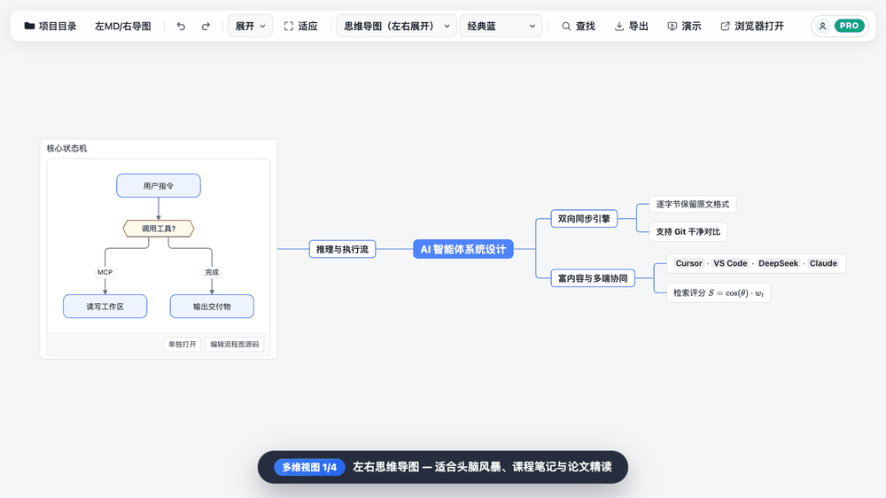
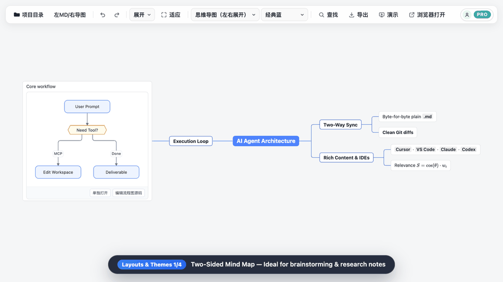

# Inkmap 墨图 — 可双向编辑的 Markdown 思维导图 & Mermaid 流程图工作台

[**English Guide ↓**](#english) · [**⚡ 在线免安装即刻试玩 (Live Playground)**](https://www.zhiyuanv.com/inkmap.html) · [**🌐 官网与使用文档**](https://www.zhiyuanv.com/software.html)

告别传统 **Markmap**「只能看、不能改」的痛点！**Inkmap** 让你像操作飞书脑图 / XMind 一样在画布上直接增删、拖拽节点与内嵌 **Mermaid 流程图**，每一处修改都**逐字节实时写回原 `.md` 文件**，未改动段落 100% 原样保留，Git diff 干净利落。


---

## 🚀 3 秒上手：如何在编辑器中使用 Inkmap？

安装插件后，打开任意 `.md` 或 `.markmap.md` 文件即可通过以下任一方式启动：

1. **一键并排分栏联动（最常用）**：点击编辑器右上角标题栏的 **「导图分栏图标」**，左侧写 Markdown、右侧交互改脑图，光标与导图节点实时双向定位跳转。
2. **文件树 / 标签页右键打开**：在左侧资源管理器或编辑器标签页右键 `.md` 文件，选择 **「Open as Inkmap」**。
3. **与 AI 对话无缝协同**：在导图中选中任意节点或框选片段，点击 **「添加到对话 (Add to Chat)」**（或右键菜单），即可将该分支精准投喂给 Cursor / Copilot / Claude 对话框；AI 改写 `.md` 后导图实时自动刷新！
4. **全屏浏览器三栏工作台**：点击导图工具栏右上角的 **「浏览器打开」**，一键在 Chrome 中展开「左侧项目目录树 + 中间源码 + 右侧大画布」全屏精修。

---

## ✨ 三大核心能力动态展示

### 1. 脑图节点内嵌 Mermaid 流程图、LaTeX 公式与表格
在列表项或标题下缩进编写 ` ```mermaid ` 代码块，Inkmap 会在节点内直接高清渲染**流程图、时序图、状态图**，同时完整支持 **LaTeX 数学公式**（`$...$` / `$$...$$`）与 **Markdown 表格**。点击图下方的 **「编辑流程图源码」**（或按 `⌘E` / `Ctrl+E`）即可边改边看，点击 **「单独打开」** 可全屏无损缩放检视复杂架构图：


### 2. 9 种专业结构切换 · 夜色护眼深色模式 · 一键当 PPT 演示放映
内置 **逻辑结构图、左右思维导图、组织结构图、目录组织图、时间轴（横向/交错/竖向）、鱼骨图** 及 **夜色深色主题**。点击顶部 **「演示」** 按钮即可进入逐节点聚光灯放映模式，方案评审与组会汇报无需重做 PPT；支持一键导出**高清 PNG、矢量 SVG 与单文件离线交互 HTML**：



### 3. 全套顺手快捷键（零学习成本）

| 常用操作 | 快捷键 / 操作方式 | 进阶操作 | 快捷键 / 操作方式 |
| :--- | :--- | :--- | :--- |
| **新增子节点** | `Tab` | **编辑节点公式 / 表格 / 流程图源码** | 双击节点 或 `⌘E` / `Ctrl+E` |
| **新增同级节点** | `Enter` | **上下调整同级节点顺序** | `⌘↑` / `⌘↓`（Win: `Alt+↑` / `Alt+↓`） |
| **新增父级节点** | `Shift + Tab` | **一键展开选中节点全部子孙** | `Shift + /` 或右键菜单 |
| **直接改写文字** | 选中节点直接打字 或 双击 | **全图关键字查找与批量替换** | `⌘F` / `Ctrl+F` |
| **删除节点 / 拖拽重组** | `Delete` / `Backspace` / 鼠标拖拽 | **撤销 / 重做（与编辑器共用历史）** | `⌘Z` / `⇧⌘Z`（Win: `Ctrl+Z` / `Ctrl+Y`） |

---

## 🎁 7 天免登录免费试用 & Inkmap Pro 终身会员

首次安装自动开启 **7 天全功能免费试用**（免注册免登录，所有 `.md` 文件始终 100% 保存在本地磁盘）。

- **一次买断 · 永久使用（无任何订阅续费）**：
  - 点击导图工具栏右上角账号徽章即可在**插件内直接开通 Pro 终身版**（支持 14 天无理由退款）。
  - **跨平台全客户端通用**：登录同一邮箱即可在 **Cursor、VS Code、Trae、Windsurf、DeepSeek Harness、Qoder、WorkBuddy、Claude Desktop、Claude Code、OpenAI Codex、Google Antigravity** 全端自动同步激活 Pro 权益，免费包含后续全部版本更新。

---

<a id="english"></a>

## English Guide

[**⚡ Try Zero-Install Live Playground in Browser**](https://www.zhiyuanv.com/inkmap.html?lang=en) · [**🌐 Official Website & Docs**](https://www.zhiyuanv.com/software.html?lang=en)

**Inkmap** is the two-way editable **Mindmap / Markmap** & **Mermaid** flowchart workspace for plain local Markdown (`.md`, `.markmap.md`). Edit, reorder, or drag nodes directly on the canvas — every change writes straight back to your Markdown file while keeping untouched lines **byte-for-byte identical** for clean Git diffs.


### How to Use in 3 Seconds

1. **Side-by-Side Split View**: Open any `.md` file and click the **Mindmap split icon** in the top-right editor toolbar (or right-click any `.md` file -> **Open as Inkmap**). Move your cursor in Markdown to highlight the node, or click any node to jump to its exact line.
2. **Send Branches to AI Chat**: Select a node (or text inside a node) and click **Add to Chat** to send exact line ranges straight into Cursor / Copilot / Claude chat.
3. **Full-Screen 3-Column Browser IDE**: Click **Open in Browser** in the toolbar to launch a full-screen workspace with a Project File Tree + live Markdown pane + mind map canvas.

### Inline Mermaid Flowcharts, KaTeX Math & Markdown Tables

Place fenced ` ```mermaid ` blocks, `$...$` / `$$...$$` LaTeX formulas, or Markdown tables inside any bullet or heading — click **Edit diagram source** (`⌘E` / `Ctrl+E`) to edit live or pop out complex diagrams in a lossless zoom modal:


### 9 Layouts, Dusk Dark Theme, Presentation Mode & Lossless Export

Switch between **Logic Chart, Mind Map, Org Chart, Catalog, Timelines, and Fishbone**, toggle **Dusk dark mode**, walk through branches step-by-step in **Presentation Mode**, and export crisp **PNG, vector SVG, or standalone interactive HTML**:



### 7-Day Free Trial & Lifetime Pro License

- **7-Day Full-Featured Free Trial** out of the box — no sign-in required, and your `.md` files never leave your machine.
- **One-Time Lifetime Pro License** (no recurring subscriptions): Upgrade directly inside the plugin's top-right account menu and sync your Pro entitlement across **Cursor, VS Code, Windsurf, Trae, Claude Desktop, Claude Code, OpenAI Codex, Google Antigravity, Qoder, and DeepSeek Harness** with one email. See [User License Agreement](LICENSE.md).
